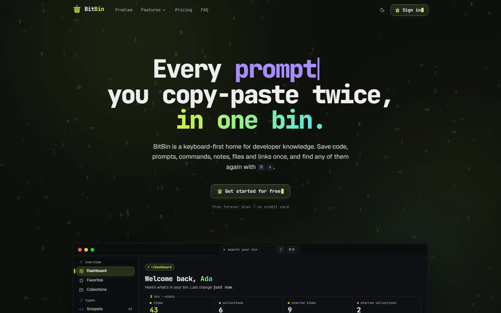
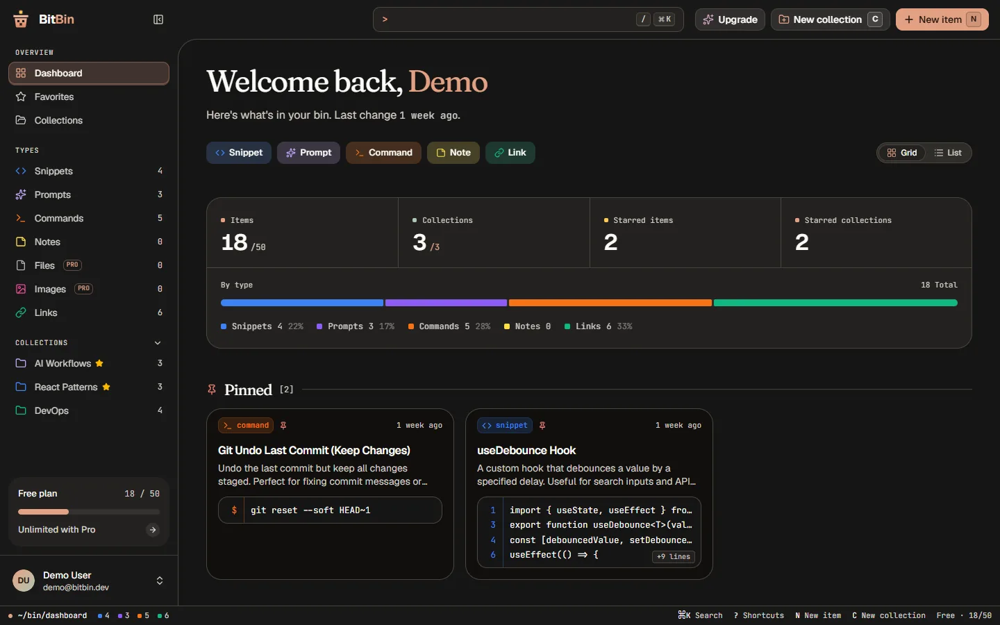
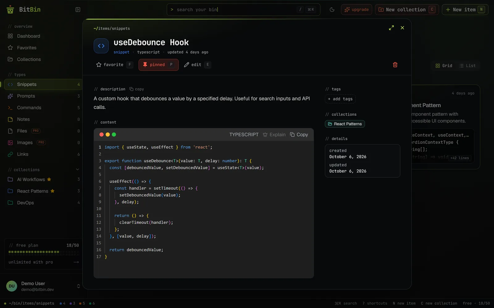
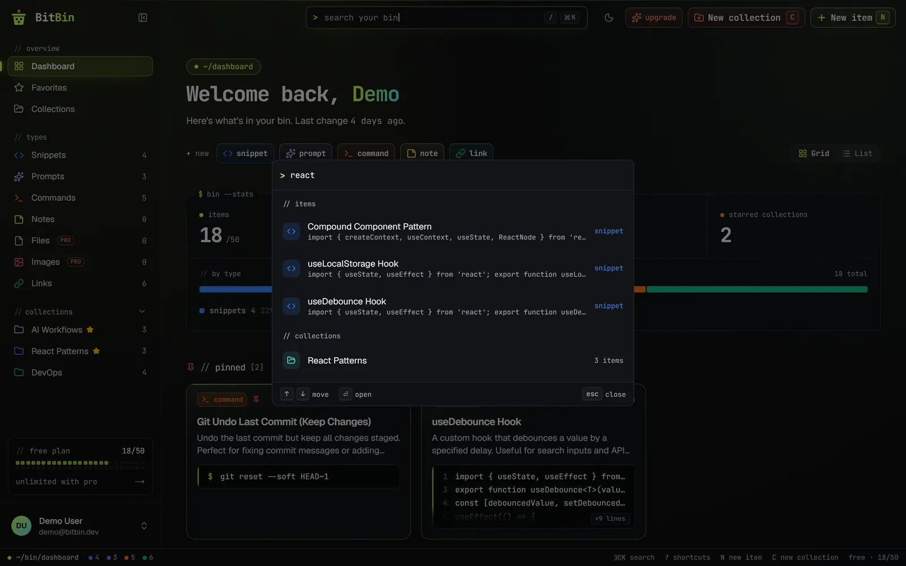
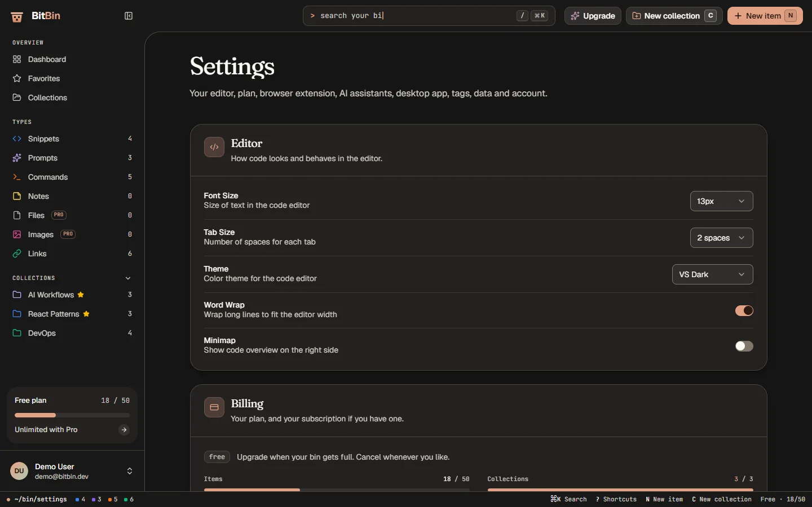
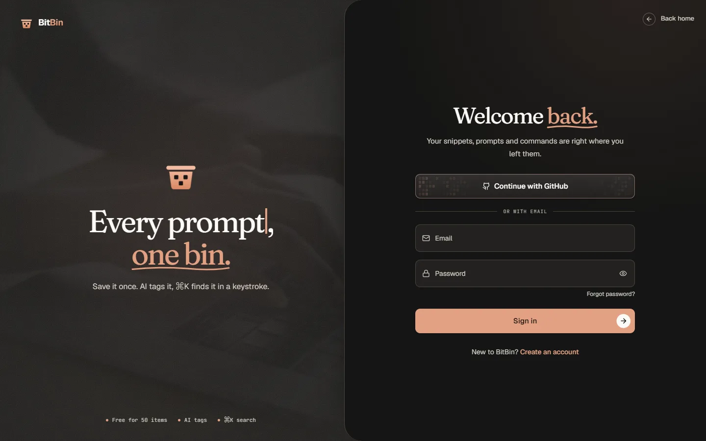
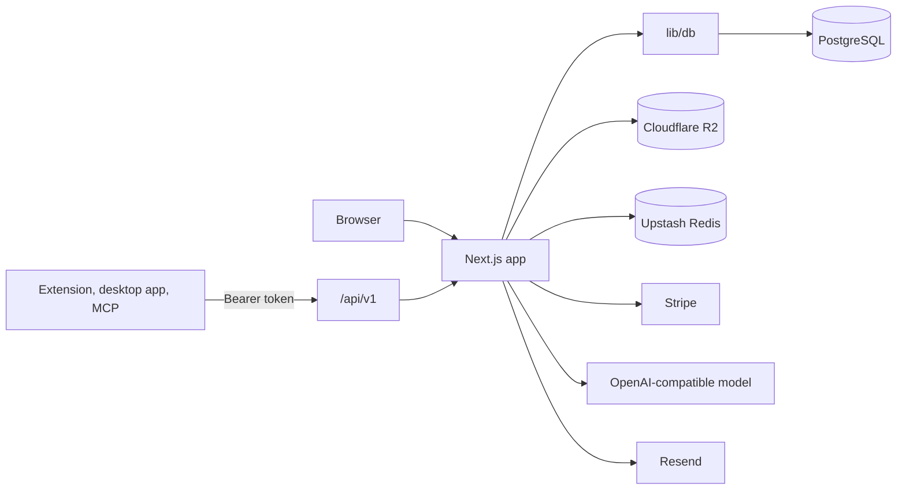
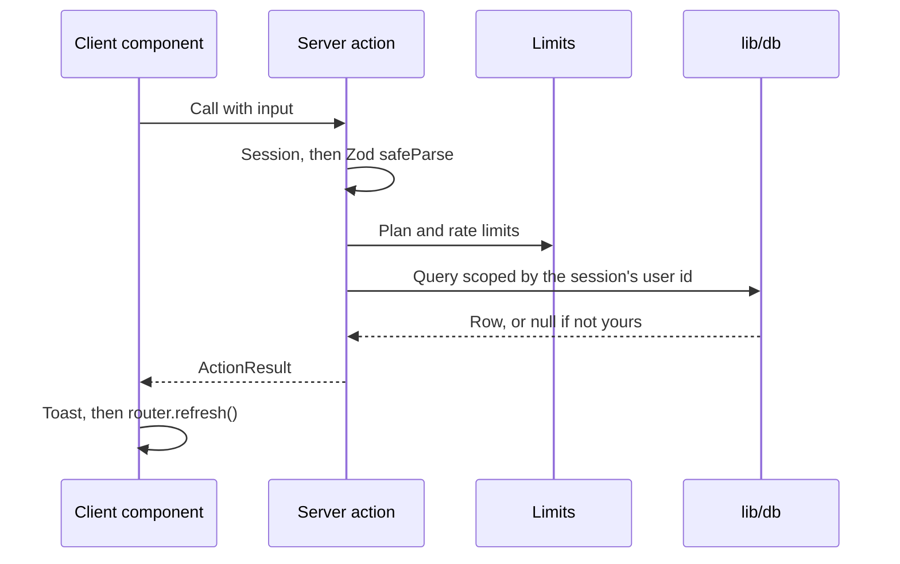

<p align="center">
  <a href="https://bitbin.divyanshuagrahari.dev"></a>
</p>

<p align="center">
  <b>Every snippet, prompt &amp; command, in one bin.</b><br/>
  A fast, searchable home for developer knowledge, on one Next.js app with no separate API server.
</p>

<p align="center">
  <a href="https://github.com/Divyanshu2805/bitbin/actions/workflows/ci.yml"></a>
  
  
  
  
  
  <a href="LICENSE"></a>
</p>

---

Developers keep their essentials scattered across editor snippets, browser bookmarks, chat threads, shell history and random folders. BitBin pulls all of it into one place: snippets, prompts, commands, notes, links, files and images, grouped into collections, tagged, and found again with ⌘K.

It also saves from wherever you are. A browser extension saves the text you selected on a page, a desktop tray app saves the clipboard with a global shortcut, and AI assistants such as Claude can search and save through an MCP server.

## Try it

| | |
|---|---|
| **App** | [bitbin.divyanshuagrahari.dev](https://bitbin.divyanshuagrahari.dev) |
| **Demo login** | `demo@bitbin.dev` / `12345678` |
| **Test card** | `4242 4242 4242 4242`, any future date, any CVC |

The demo account is shared and resets every day, so it can't change its password, name or plan, save links or import. Register with an email to get your own account. The verification link comes from `noreply@bitbin.divyanshuagrahari.dev`, so check your spam folder if it doesn't show up. Payments run in Stripe test mode and no money moves.

<p align="center">
  
</p>

## Features

**Capture and organize**
- Seven item types: snippets, prompts, commands, notes, links, files and images.
- Collections: an item can be in many, collections can be pinned and favourited, and items can be dragged onto them.
- Tags with rename, merge and delete, favourites, pins, and a grid or list view.
- A Monaco code editor that detects the language (31 languages), and a Markdown editor with a GitHub-flavoured preview.
- Search as you type with <kbd>⌘</kbd> / <kbd>Ctrl</kbd> + <kbd>K</kbd>, `#tag` filters, and a keyboard shortcut for everything (<kbd>?</kbd> lists them).

**AI helpers (Pro)**
- Tag suggestions, a description writer, "Explain this code" and a prompt optimizer, on OpenAI or any OpenAI-compatible provider.

**Save from anywhere (Pro)**
- A Chrome and Edge extension: <kbd>Ctrl</kbd> + <kbd>B</kbd> saves the selection, titled from the page's heading, with a link back.
- A desktop tray app: <kbd>Ctrl</kbd> + <kbd>Alt</kbd> + <kbd>B</kbd> saves the clipboard, a copied screenshot or a file from any app.
- An MCP server, so an assistant can search the bin, read an item and save into a collection by name.
- All three use personal access tokens that are hashed, expiring, revocable and limited to the permissions they were made with.

**Your data stays yours**
- Export the whole library or one collection: JSON for everyone, and for Pro a ZIP with the text items as readable files and every uploaded file.
- Import either format back, with a preview, duplicate skipping and the original dates, in one all-or-nothing transaction.

| | Free | Pro ($8 / month or $72 / year) |
|---|---|---|
| Items / collections | 50 / 3 | Unlimited |
| Files and images | | ✓ |
| AI helpers | | ✓ |
| Extension, desktop app, MCP | | ✓ |
| Export and import | JSON | JSON and ZIP with files |

## Engineering highlights

Measured on 1,000,000 synthetic items in a local Postgres. Details in [docs/results.md](docs/results.md).

- **Rare-word search: 311 ms → 0.11 ms** in a 100,000-item account. The search was split so its trigram indexes serve it.
- **Tag-name search: 344 ms → 33 ms**, and **20.8 ms → 12.6 ms** in a 5,000-item account once matching tags are looked up first.
- **Deep list pages: 45.6 ms → 9.3 ms** 90% down a 40,000-snippet list. Cursor pages read in index ranges instead of `OFFSET`.
- **Free-plan limits hold under concurrency.** Counts and inserts run in one transaction under a row lock, so two requests at 49 items can't both get through.
- **1,007 tests**, about 86% coverage of the server code, and Lighthouse accessibility 100 on all 12 pages measured.

## Screenshots

| | |
|---|---|
|  |  |
| An item in the drawer | ⌘K search |
|  |  |
| Settings | Sign in |

## How it works



| Part | Does |
|---|---|
| Pages | React Server Components that read through `lib/db`, the only module that touches Prisma |
| Server actions | Every write from the UI: session, Zod, plan and rate limits, a query scoped to the user, a typed result |
| Route handlers | Only where a real URL is needed: auth emails, file transfer, export and ZIP import, Stripe, two crons |
| Token API | `/api/v1` for the extension, the desktop app and assistants, reusing the same create and AI logic |

Every write from the UI goes like this:



The user id only ever comes from the session or the token, and another user's row looks exactly like a missing one. Files sit in a private bucket and are read through an ownership-checked, streamed route. The Content Security Policy lets nothing third-party into a page, so the code editor is served from the app's own origin.

More detail in [docs/architecture.md](docs/architecture.md).

## Stack

| | |
|---|---|
| App | Next.js 16 (App Router), React 19 with the React Compiler, TypeScript 5 |
| Data | PostgreSQL on Neon, Prisma 7 with the `pg` adapter, trigram indexes for search |
| Auth | NextAuth v5, email and GitHub, JWT sessions that can be revoked |
| UI | Tailwind CSS v4, shadcn/ui, Monaco, cmdk |
| Services | Cloudflare R2, Upstash Redis, Stripe, OpenAI or compatible, Resend, Sentry |
| Clients | Chrome and Edge MV3 extension, Electron desktop app |
| Testing | Vitest, `node:test`, GitHub Actions |

## Running locally

You need Node 20+ and a PostgreSQL database. A free [Neon](https://neon.tech) project works.

```bash
git clone https://github.com/Divyanshu2805/bitbin.git
cd bitbin
npm install
cp .env.example .env      # set DATABASE_URL and AUTH_SECRET
npm run db:migrate
npm run db:seed
npm run dev
```

Open http://localhost:3000 and sign in as `demo@bitbin.dev` / `12345678`. Every other service switches on one area of the app, and it runs without them. Setting them up is covered in [docs/development.md](docs/development.md).

## Testing and CI

| Suite | |
|---|---|
| Unit | 1,007 tests in 83 files: every server action, the library code and every route handler, with all services mocked |
| Desktop app | 46 tests |
| Coverage | About 86% of `src/actions`, `src/lib` and `src/app/api`, with an 80% floor |

Every push and pull request runs a production dependency audit, lint, the tests with the coverage floor and a build. Vercel deploys every push to `main`, and migrations are applied to production before the code that needs them. See [docs/deployment.md](docs/deployment.md).

## Docs

| | |
|---|---|
| [Architecture](docs/architecture.md) | Layers, flows, search, files, the token API, security |
| [API](docs/api.md) | Endpoints, server actions, errors, rate limits, MCP |
| [Data model](docs/data-model.md) | Tables, item types, indexes, migrations |
| [Development](docs/development.md) | Setup, config, tests, troubleshooting |
| [Deployment](docs/deployment.md) | Production, CI, operations |
| [Results](docs/results.md) | How the numbers were measured |
| [Extension](extension/README.md) · [Desktop app](desktop/README.md) | Installing and running them |

## License

[MIT](LICENSE) · [Privacy Policy](https://bitbin.divyanshuagrahari.dev/privacy) · [Terms of Service](https://bitbin.divyanshuagrahari.dev/terms)
