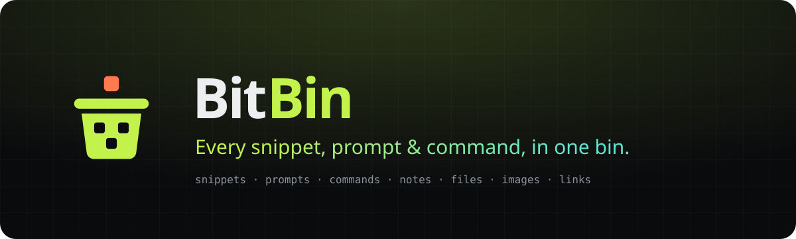
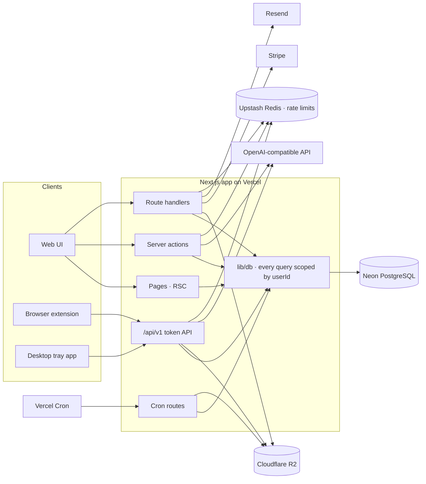

<p align="center">
  
</p>

<p align="center">
  <b>Every snippet, prompt &amp; command, in one bin.</b><br/>
  A fast, searchable home for developer knowledge.
</p>

<p align="center">
  <a href="https://github.com/Divyanshu2805/bitbin/actions/workflows/ci.yml"></a>
  
  
  
  
  
</p>

<p align="center">
  <a href="https://bitbin.divyanshuagrahari.dev"><b>bitbin.divyanshuagrahari.dev</b></a>
</p>

---

Developers keep their essentials scattered across editor snippets, browser bookmarks, chat threads, shell history and random folders. **BitBin** pulls all of it into one place: organized, tagged and a keystroke away, from the web app, a browser extension or a desktop tray app.

## Try it

| | |
|---|---|
| **Live app** | [bitbin.divyanshuagrahari.dev](https://bitbin.divyanshuagrahari.dev) |
| **Demo login** | `demo@bitbin.dev` / `12345678` (a shared, public sandbox: it can't change its own password, name or plan, and its library is reset every day) |
| **Your own account** | Register with an email: a verification link arrives from `noreply@bitbin.divyanshuagrahari.dev`. The sending domain is new, so **check your spam folder** if it doesn't show up |
| **Upgrading** | Production runs Stripe in **test mode**: use card `4242 4242 4242 4242`, any future date and any CVC. No money moves |

## Features

**Capture and organize**
- Seven item types: **snippets, prompts, commands, notes, links, files and images**
- Collections: an item can belong to many, collections can be favorited and pinned, and items can be dragged onto them
- Tags with rename, merge and delete, favorites, pins, and a grid or list view remembered per browser
- Monaco code editor with language auto-detection (31 languages), and a markdown editor with GitHub-flavored preview
- Server-side search as you type (<kbd>⌘</kbd> / <kbd>Ctrl</kbd> + <kbd>K</kbd>), `#tag` filters, and keyboard shortcuts for everything (<kbd>N</kbd> new item, <kbd>C</kbd> new collection, <kbd>G</kbd> then a letter to navigate, <kbd>1</kbd>–<kbd>7</kbd> for each type, <kbd>?</kbd> for the full list)
- Dark-first "graphite + lime" interface, a light theme held to WCAG AA contrast, motion that respects `prefers-reduced-motion`

**AI helpers (Pro)**: tag suggestions, a description generator, "Explain this code" and a prompt optimizer, on OpenAI or any OpenAI-compatible provider, including models without a JSON mode.

**Save from anywhere (Pro)**

Two companion apps get things into BitBin without opening it. Both use the same token API ([`/api/v1`](docs/api/token-api.md)) with personal access tokens that are hashed, expiring, revocable, and limited to the permissions they were created with.

| | Browser extension | Desktop tray app |
|---|---|---|
| Platform | Chrome and Edge (Manifest V3) | Windows installer; macOS and Linux from source (Electron) |
| Trigger | <kbd>Ctrl</kbd> + <kbd>Shift</kbd> + <kbd>B</kbd> (<kbd>⌘</kbd> + <kbd>Shift</kbd> + <kbd>B</kbd> on macOS), or right-click → *Save selection to BitBin* | <kbd>Ctrl</kbd> + <kbd>Alt</kbd> + <kbd>B</kbd> (<kbd>⌘</kbd> + <kbd>⌥</kbd> + <kbd>B</kbd> on macOS) from any app, or the tray icon |
| What it saves | The selected text, titled from the page's heading, with a link back | The clipboard (text or a screenshot), or a file you attach or drop |
| Extras | Type and language guessing, collection picker, tags, **✦ Suggest** (AI tags and description) | Type guessing, collection picker, tags, **✦ Suggest**, start at login, a changeable shortcut |
| Install | Download the ZIP from **Settings → Browser extension** and load it unpacked | **Settings → Desktop app**, or run it from [`desktop/`](desktop/README.md) |

The desktop app keeps its token in the main process, encrypted with the OS keychain where one exists, and runs its windows sandboxed with no Node access. How each works: [save from anywhere](docs/architecture/flows/save-from-extension.md), [save from the desktop](docs/architecture/flows/save-from-desktop.md).

**Your data stays yours**
- Export the whole library or one collection: JSON for everyone, and for Pro a ZIP that also holds your snippets, prompts, commands and notes as readable files plus every uploaded file
- Import either format back (ZIP imports restore the files), with a preview, duplicate skipping and original dates, in one all-or-nothing transaction
- Account deletion removes your items, files and subscription

Everything, with its limits: [features](docs/features.md).

### Plans

| | Free | Pro ($8 / month or $72 / year) |
|---|---|---|
| Items / collections | 50 / 3 | Unlimited |
| Snippets, prompts, commands, notes, links | ✓ | ✓ |
| Files and images | | ✓ |
| AI helpers | | ✓ |
| Extension, desktop app and token API | | ✓ |
| Export and import | JSON | JSON and ZIP (with files) |

Limits are enforced on the server (under a row lock, so concurrent requests can't overshoot them); the UI only mirrors them.

## Architecture

BitBin is one Next.js 16 App Router application with no separate API server. Pages are React Server Components that read through `lib/db`, the only module that touches Prisma. Every UI write is a **server action** that checks the session, validates with Zod, applies plan and rate limits, and runs a query scoped to the signed-in user. Route handlers exist only where real HTTP is needed: auth flows, file transfer, export and ZIP import, Stripe, two crons, and the token API used by the extension and the desktop app.



| Area | Choice |
|---|---|
| Framework | Next.js 16 (App Router), React 19 with the React Compiler, TypeScript 5 |
| Data | PostgreSQL (Neon) with Prisma 7 and the `pg` driver adapter; 10 models, 9 migrations, trigram indexes for search |
| Auth | NextAuth v5: credentials and GitHub, JWT sessions that can be revoked |
| Styling | Tailwind CSS v4 + shadcn/ui |
| Services | OpenAI (or compatible), Stripe, Cloudflare R2, Upstash Redis, Resend, Sentry |
| Clients | Chrome / Edge MV3 extension, Electron desktop app |
| Quality | Vitest, ESLint, GitHub Actions CI with a coverage floor |

More in the [architecture overview](docs/architecture/README.md), the [decision records](docs/architecture/decisions/README.md) and the [tech stack](docs/tech-stack.md).

## Security

The rules are written down in the [security guardrails](docs/practices/security-guardrails.md) and the [security model](docs/architecture/security-model.md). In short:

- **Tenant isolation in code:** the user id comes only from the session (or the API token), every query is scoped by it, and any id or file URL from the client is checked for ownership. Another user's row looks exactly like a missing one.
- **Accounts:** bcrypt (cost 12), hashed and single-use email tokens, 14-day revocable sessions, identical answers whether or not an email has an account, per-IP and per-address rate limits on every public auth endpoint, and an open-redirect-safe sign-in.
- **Browser:** a Content Security Policy that lets nothing third-party into a page (the code editor is served from the app's own origin, not a CDN), and cross-site checks on every cookie-authenticated route that changes state.
- **API tokens:** hashed, always expiring, and limited to the permissions they were created with (`collections:read`, `items:write`, `files:write`, `ai`).
- **Files** live in a private R2 bucket and are read only through an ownership-checked, streamed route. Every stored file, from the web, the desktop app or a ZIP import, is checked by extension, type, size and file signature; photos are re-encoded so location metadata is never stored; ZIP imports are capped while they inflate; and a weekly sweep removes files no item points at.
- **Payments:** the Stripe webhook verifies the raw body's signature and syncs the plan from Stripe, so retried or out-of-order events are harmless.
- **Operations:** security headers, Sentry with personal data stripped, scripts that refuse to touch a production database, a production dependency audit in CI (0 known vulnerabilities) and secret scanning.

Found a problem? See [SECURITY.md](SECURITY.md).

## Quality

| | |
|---|---|
| Tests | 903 unit tests across 77 files (actions, library code and every route handler), all external services mocked; 41 more for the desktop app |
| Coverage | about 85% of statements over `src/actions`, `src/lib` and `src/app/api`, with an 80% floor enforced in CI |
| CI | audit, lint, tests with the coverage floor and a build on every push and pull request |
| Lighthouse (production build) | accessibility 100, SEO 100, best practices 96, performance 80–95 across 12 pages |
| Concurrency | the Free-plan limits and single-use email links are covered by race tests |

Details and what is checked by hand are in [testing](docs/practices/testing.md); every figure, and how to re-measure it, is on the [metrics page](docs/metrics.md).

## Quick start

Requires Node 20+ (CI uses 22) and a PostgreSQL database (a free [Neon](https://neon.tech) project works).

```bash
git clone https://github.com/Divyanshu2805/bitbin.git
cd bitbin
npm install
cp .env.example .env      # set DATABASE_URL and AUTH_SECRET at minimum
npm run db:migrate        # create the schema
npm run db:seed           # system item types + the demo account
npm run dev
```

Open <http://localhost:3000> and sign in as `demo@bitbin.dev` / `12345678`.

`.env.example` only holds `YOUR_…` placeholders; each optional service (GitHub, Resend, Upstash, R2, Stripe, an AI provider, Sentry) switches on one area of the app, and the app runs without them. See [setup](docs/local-development/setup.md) and [configuration](docs/local-development/configuration.md).

### Commands

```bash
npm run dev               # dev server on http://localhost:3000
npm run lint && npm run test && npm run build   # before every push (CI runs these too)
npm run test:coverage     # tests plus a coverage report; fails below the floor
npm run db:migrate        # schema change → new migration (never db push)
npm run db:seed           # system item types + the demo account
```

The full list is in [commands](docs/local-development/commands.md).

## Repository layout

```
src/app/            pages and route handlers (App Router)
src/actions/        server actions: every write from the UI
src/lib/            validation, plan and rate limits, shared logic, integrations, db/ (every query)
src/components/     UI: shadcn primitives, layout, items, dashboard, settings, homepage
prisma/             schema, migrations, seed and the demo library
extension/          Chrome / Edge extension (plain JS, outside the Next build)
desktop/            Electron tray app (plain CommonJS, own package.json and tests)
docs/               documentation
.github/workflows/  CI, and the desktop installer release
```

## Deployment

Live at [bitbin.divyanshuagrahari.dev](https://bitbin.divyanshuagrahari.dev). Vercel builds and deploys every push to `main`; the database (Neon), storage (Cloudflare R2), rate limiting (Upstash) and payments (Stripe) are managed services, and two Vercel crons reset the demo account daily and sweep orphaned files weekly. Migrations are applied by hand before a deploy that needs them. GitHub Actions runs the checks in parallel, without gating the deploy.

See [deployment](docs/deployment/README.md), [operations](docs/deployment/operations.md) and the [smoke test](docs/deployment/smoke-test.md).

## Known limitations

Deliberately not built: end-to-end tests, per-device session lists, email change and OAuth account linking, custom item types, sharing, relevance-ranked or fuzzy search, Stripe live mode, store-published extension builds, and signed, auto-updating desktop builds. The host refuses request bodies over about 4.5 MB, so web uploads above 4 MB go up in parts and downloads and ZIP exports are streamed; the desktop app and ZIP imports still stop at 4 MB. The legal pages are generic rather than lawyer-reviewed. The trade-offs the design accepts are in [constraints and trade-offs](docs/known-gaps/constraints-and-trade-offs.md).

## Documentation

Everything lives in [`docs/`](docs/README.md):

| Section | Covers |
|---|---|
| [Features](docs/features.md) | Everything the app does, with the plans and limits |
| [Local development](docs/local-development/README.md) | Prerequisites, setup, configuration, commands, troubleshooting |
| [Architecture](docs/architecture/README.md) | Layers, module map, request flows, security model, decision records |
| [Data model](docs/schema/README.md) | Tables, item types, conventions, migrations |
| [API reference](docs/api/README.md) | Route handlers, server actions, the token API, export format, errors and rate limits |
| [Browser extension](extension/README.md) · [Desktop app](desktop/README.md) | What they do, installing, running locally, releasing |
| [Engineering practices](docs/practices/README.md) | Conventions, guardrails, testing and CI, design system, pitfalls, definition of done |
| [Project metrics](docs/metrics.md) | Measured quality, accessibility, security and scale figures |
| [Known gaps](docs/known-gaps/README.md) | Trade-offs, behaviour that looks like a bug, remaining work |
| [Deployment](docs/deployment/README.md) | Vercel, CI, provider callbacks, operations, smoke test |
| [Contributing](CONTRIBUTING.md) · [Security](SECURITY.md) | Workflow and checks; reporting a vulnerability |

## License

Released under the [MIT License](LICENSE).

## Legal

[Privacy Policy](https://bitbin.divyanshuagrahari.dev/privacy) · [Terms of Service](https://bitbin.divyanshuagrahari.dev/terms)
