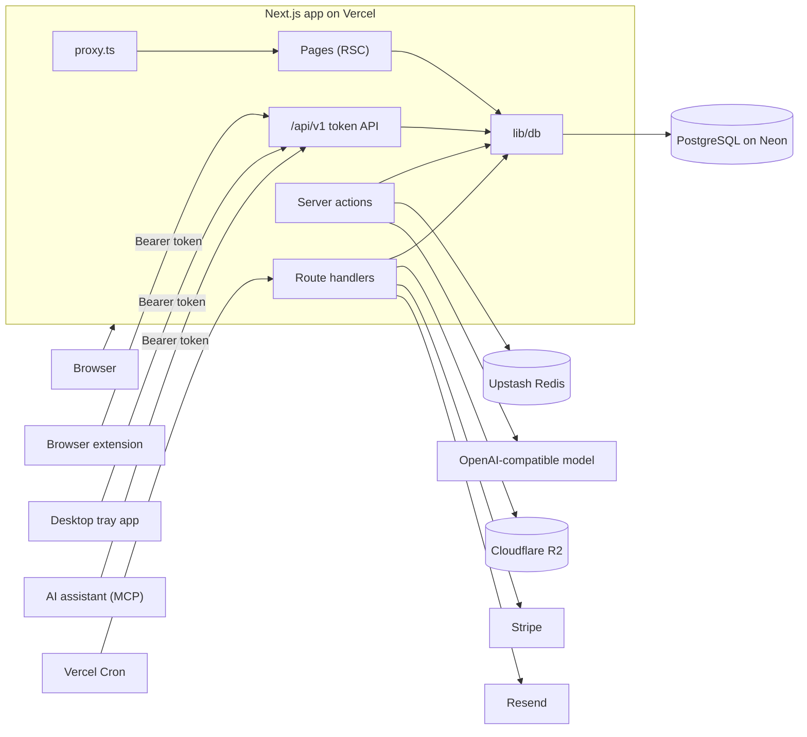
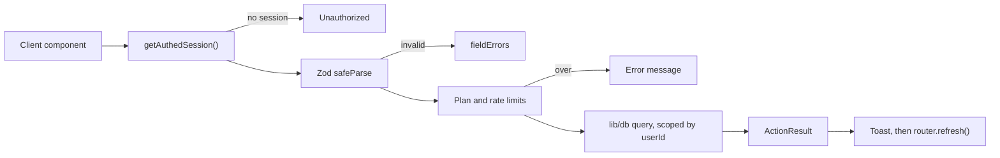
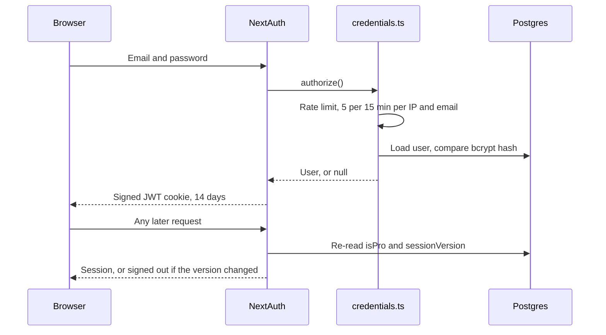
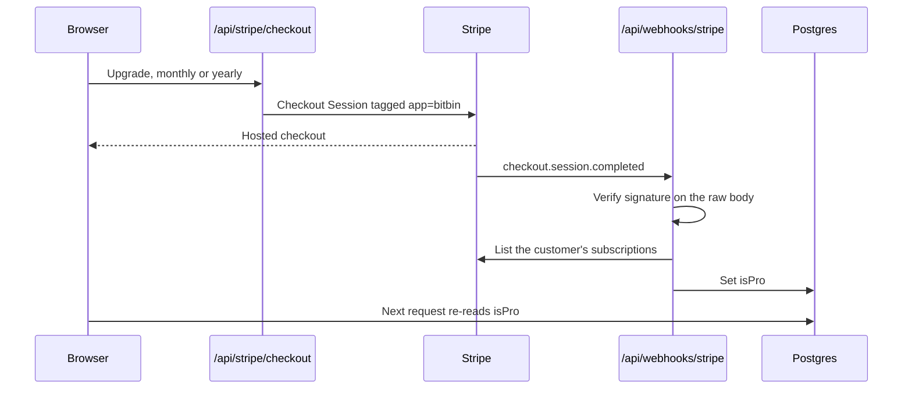
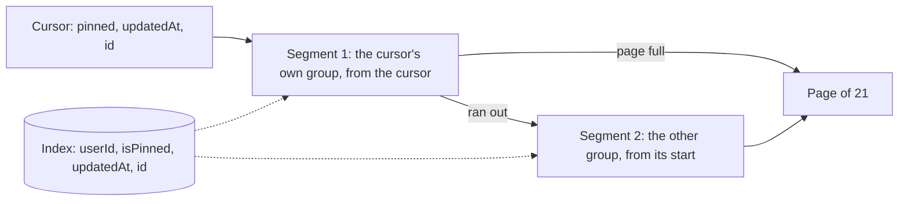
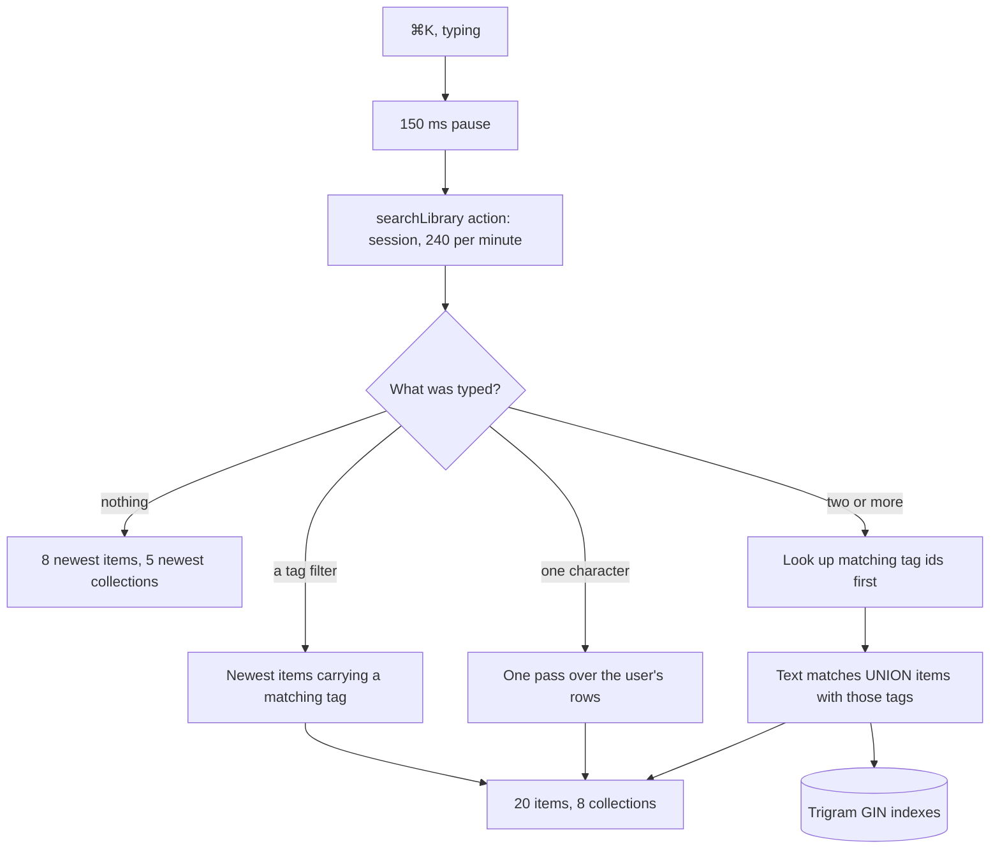
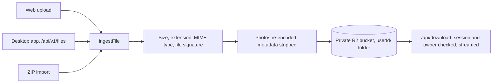
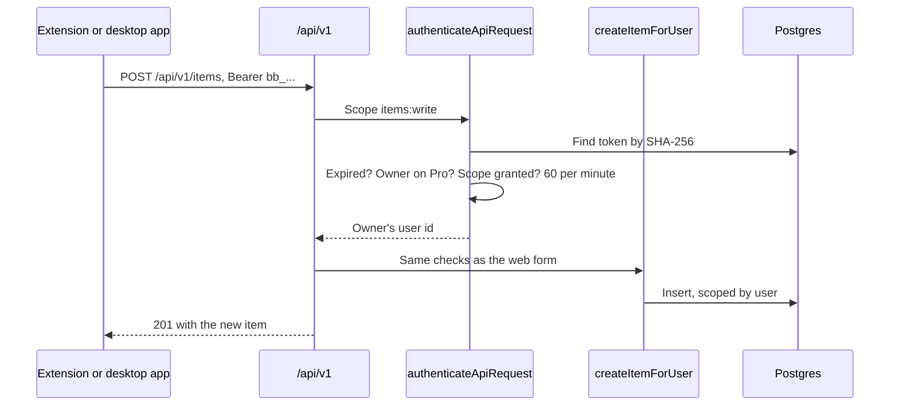
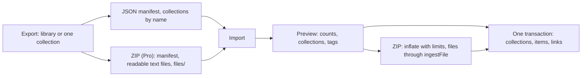

# Architecture

## Overview

BitBin is one Next.js 16 App Router application. There is no separate API server: pages are React Server Components that read through `lib/db`, every write from the UI is a server action, and route handlers cover only what needs a real URL.

| Layer | Where | Does |
|---|---|---|
| Proxy | `src/proxy.ts` | Sends a signed-out request for `/dashboard/*` to sign-in. Every other page checks the session itself |
| Pages | `src/app/**/page.tsx` | Call `auth()`, redirect when signed out, load data in parallel from `lib/db`, render |
| Server actions | `src/actions/*.ts` | Every write from the UI: session, Zod, plan and rate limits, a scoped query, an `ActionResult` |
| Route handlers | `src/app/api/**/route.ts` | Auth emails, file transfer, export and ZIP import, Stripe, the token API, two crons |
| Shared logic | `src/lib/{item-create,collection-create,ai-tags,ai-description,file-ingest}.ts` | One path per behaviour, used by the actions, the routes and `/api/v1` alike, so no way in skips a check |
| Data access | `src/lib/db/*.ts` | Every Prisma query, always scoped by the caller's user id. The only module that imports the Prisma client |
| Integrations | `src/lib/{stripe,r2,openai,email,rate-limit,monitoring}.ts` | Thin wrappers. Business rules stay in the action or route |

| Service | Used for |
|---|---|
| PostgreSQL (Neon) | All application data, through Prisma 7 and the `pg` driver adapter |
| Cloudflare R2 | File and image bytes, in a private bucket |
| Upstash Redis | Sliding-window rate limits |
| Stripe | Checkout, the Customer Portal, subscription webhooks |
| OpenAI or any compatible provider | Tag suggestions, descriptions, code explanations, prompt rewrites |
| Resend | Verification and password-reset emails |
| GitHub OAuth | Sign-in |
| Sentry | Server errors, with personal data stripped |
| Vercel Cron | The daily demo reset and the weekly sweep of unused files |

## A write

Every change made in the UI goes through the same steps:

- An action never throws to the client. It returns `{ success, data?, error?, fieldErrors? }`, and `error` is a sentence the toast shows as it is.
- The user id comes from the session only. No endpoint takes one from a body, query string or path.
- A row that belongs to someone else is reported exactly like a missing one, so ids can't be probed.
- There is no client-side data cache. After a successful action the component calls `router.refresh()`, and the server components on the page fetch again.

## Sign-in

- Email and password accounts are verified by email. GitHub is the second provider, run as a server action so the redirect can't race the session cookie. A GitHub sign-in for an address that already has a password account is refused rather than linked.
- Sessions are JWTs. The `jwt` callback re-reads `isPro` and `sessionVersion` on every evaluation, so a Stripe upgrade shows up on the next request, and a password change, a reset or **Sign out everywhere** ends every older session.
- Verification and reset links hold 32 random bytes. Only their SHA-256 is stored, they expire (24 hours and 1 hour), and they are spent with a delete that must remove exactly one row, so two requests can't both use one.
- Register, forgot password and resend verification give the same answer whether or not the address has an account, and each is limited per IP and per address.

## Plans and billing

| | Free | Pro ($8 / month or $72 / year) |
|---|---|---|
| Items / collections | 50 / 3 | Unlimited |
| Files (10 MB) and images (5 MB) | | ✓ |
| AI helpers | | ✓ |
| API tokens, extension, desktop app, MCP | | ✓ |
| Export and import | JSON | JSON and ZIP with files |

- Every plan-changing event just calls `syncPlanFromStripe`, which reads the customer's subscriptions from Stripe. Retried or out-of-order events can't leave the wrong plan.
- Checkouts carry `metadata.app = bitbin`, and the webhook ignores any that don't, so the Stripe account can be shared with other apps.
- Free limits are counted and written under a lock: `createItem`, `createCollection` and `importData` re-count inside a transaction after `SELECT … FOR UPDATE` on the user's row, so two requests at 49 items can't both get through.

## Items, collections and tags

An item is one `items` row. Its type decides which columns hold the payload, which editor opens and whether it needs Pro.

| Type | Holds | Editor |
|---|---|---|
| Snippet, command | Code and shell lines | Monaco, with a language (31 detected) |
| Prompt, note | Markdown | Markdown with a GitHub-flavoured preview |
| Link | A URL | URL field |
| File, image (Pro) | A stored object | Upload, with a PDF, text or image preview |

- Collections hold items many-to-many through `item_collections`, so one item can be in several and deleting a collection keeps its items. A collection's colour is the colour of its most common item type, worked out from a sample of 50 items, never stored.
- Tags are shared rows connected with `connectOrCreate`. Renaming, merging or deleting a tag in Settings touches only the caller's own items, and a tag nobody uses is deleted.
- The drawer opens any item from a card, a row or a search result, loads it in full through `GET /api/items/[id]`, and edits it in place. List queries select only what a card shows.

## Lists

Every list is paged by a cursor, not a page number. The cursor is the position of a row (`pinned`, `updatedAt`, `id`), and a page is the rows after or before it in the order pinned first, then last edited.

Each segment is a plain range of one index, so the scan starts at the cursor. A single `OR` across the pinned and unpinned groups would stop Postgres from doing that, and a page deep in a long list would read every row before it. This way every page, first or deep, reads about one page of rows. Counts by type read the `(userId, itemTypeId)` index. Measured on 100,000 items in [results](results.md).

## Search

- The database does the matching: a case-insensitive contains over title, content, description, URL and tag names, scoped by `userId`. Title matches come first, then the most recently edited. `#react` looks at tags only.
- Six GIN trigram indexes (`pg_trgm`) serve `ILIKE '%…%'`. Looking up the matching tags before the item query keeps the text part on those indexes and drops the tag part when no tag matches.
- `%`, `_` and `\` in the text are escaped, and the text is bound as a parameter, never put into the SQL.
- A preview is `left(content, 101)` cut in SQL, so no item's full text is loaded to draw one line.
- An answer that arrives after a newer one is dropped, and the old results stay up, dimmed, while the next search runs.

## Files

- Images go up to 5 MB, other files (PDF, text, Markdown, JSON, YAML, XML, CSV, TOML, INI) up to 10 MB. A file over 4 MB is sent in 4 MB parts and joined by the request that uses it, because Vercel refuses bodies over about 4.5 MB.
- PNG, JPEG and WebP are decoded and written out again, which removes GPS and device data and refuses anything that only starts like an image or is over 50 megapixels. An SVG with script is refused.
- Nothing reads the bucket directly. `/api/download/{key}` needs a session and a key inside the caller's own folder, reads the object with the server's credentials and streams it. Previews get the type from the extension, `nosniff` and a sandboxing policy.
- A client-supplied `fileUrl` is stored, read or deleted only after `isOwnedFileUrl` confirms it is in the caller's folder.
- A weekly cron deletes objects no item points at, but only uploads older than a day, at most 1,000 a run, and nothing when more than half of the bucket looks unused.

## Save from anywhere

The browser extension, the desktop tray app, scripts and AI assistants all use `/api/v1`, with a personal access token instead of a cookie.

| Client | Trigger | Saves |
|---|---|---|
| Browser extension (Chrome, Edge) | <kbd>Ctrl</kbd> + <kbd>B</kbd> or the context menu | The selected text, titled from the page's heading, with a link back |
| Desktop tray app (Electron) | <kbd>Ctrl</kbd> + <kbd>Alt</kbd> + <kbd>B</kbd> from any app | The clipboard, a copied screenshot, or an attached file |
| AI assistant | MCP tools at `POST /api/v1/mcp` | Search, read, list collections, save into a collection by name |

- Tokens are `bb_` plus 32 random bytes, shown once and stored as a SHA-256 hash. They expire after 30, 90 or 365 days, at most 10 per account, and carry only the scopes chosen when they were made: `collections:read`, `items:read`, `items:write`, `files:write`, `ai`.
- The owner's plan is re-read on every request, so a token stops working the moment its owner leaves Pro.
- The MCP server is stateless Streamable HTTP: one JSON-RPC message per `POST`. `tools/list` shows only the tools the token's scopes allow.
- Items leave through `toApiItem`, which gives a file's name and size but never its stored address.
- The desktop app keeps the token in the main process, encrypted with the OS keychain where there is one, and runs its windows sandboxed without Node.

## Import and export

- A ZIP export holds the JSON, the snippets, prompts, commands and notes as plain files, `links.md`, and every uploaded file. It is streamed, so its size never meets the response limit.
- An import keeps the original dates, can skip items already saved, applies the Free limits under the same lock, and either completes or changes nothing. A failed ZIP import deletes the files it had stored.
- A ZIP is inflated with every limit enforced as it goes (20 MB compressed, 10 MB per file, 100 files, 40 MB in total), so a ZIP bomb stops at the byte count.

## The demo account

`demo@bitbin.dev` / `12345678` is published so anyone can try the app. It works like a Free account, but everything that would change the account itself (password, name, deletion, billing, sign-out everywhere) refuses it through `isDemoEmail`. What it saves is shown to the next visitor, so it can't save links, items over 5,000 characters or imports. A daily cron restores its library in one transaction.

## Security

| Area | How it's handled |
|---|---|
| Tenancy | The user id comes from the session or the token only. Every `lib/db` function filters by it, and collection ids and file URLs from the client are checked for ownership |
| Passwords | bcrypt, cost 12, 8 to 128 characters, never logged or returned |
| Sessions | Signed JWT cookie, 14 days, revocable on every device through `sessionVersion` |
| Abuse | Rate limits on sign-in, registration and every email-sending route (per IP and per address), search, writes, uploads, import, export, checkout, AI and the token API |
| Cross-site requests | `SameSite=Lax` cookie, plus `rejectCrossSite` on every cookie-authenticated route that changes state |
| Redirects | `callbackUrl` goes through `safeCallbackPath`, so only a path on this site is followed |
| Browser | A Content Security Policy that allows only this site, `connect-src 'self'`, no `eval`. The code editor and the PDF reader are served from the app's own origin |
| Files | Private bucket, ownership-checked streamed reads, signature checks, photo re-encoding, capped ZIP inflation |
| Webhooks | The Stripe signature is checked on the raw body before anything else |
| Errors | Logged with `console.error`, which Sentry captures with cookies, bodies, IPs and user data removed. The client gets a generic message |
| Scripts | `db:seed` and `db:cleanup` refuse any database host not marked safe |
| Dependencies | CI fails on a high or critical advisory in a production dependency. Secret scanning with push protection is on |

## Design decisions

| Decision | Reason |
|---|---|
| One Next.js app, no separate API | One deploy, one type system, and server components that read the database directly |
| Server actions for every write | Session, validation and limits in one place, and a typed result instead of thrown errors |
| JWT sessions that re-read the plan | No session table to query, yet upgrades land at once and sessions can still be revoked |
| Files in R2 behind a download route | The bucket stays private and every read is checked against the signed-in user |
| Rate limits fail open, credentials fail closed | A Redis outage doesn't take the app down, and it can't switch off brute-force protection |
| Schema changes only through migrations | The database and the migration history never drift apart |
| A small token API for other clients | The extension, the desktop app and assistants share one checked path, with scoped, expiring tokens |
| A public demo account that can't change itself | Anyone can try the app without signing up, and the next visitor sees a clean library |
| CI on every push with a coverage floor | Server code stays tested, and Vercel still deploys on its own |
| A real CSP without script nonces | Third-party code is blocked while pages stay static |
| MCP on the token API | Assistants get the same permissions, limits and checks as every other client |
