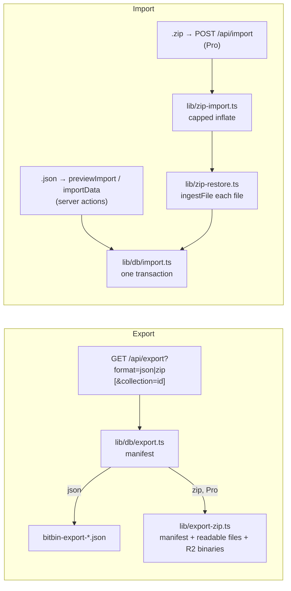

# Import and Export Flow

A user's data can leave BitBin in a readable form and come back in. Everything is under **Settings → Data**, except per-collection export, which is in a collection's ⋯ menu.

## Export

| What | Format | Plan | Request | File name |
|---|---|---|---|---|
| The library | JSON | Free and Pro | `GET /api/export?format=json` | `bitbin-export-YYYY-MM-DD.json` |
| | ZIP | Pro (`403` otherwise) | `GET /api/export?format=zip` | `bitbin-export-YYYY-MM-DD.zip` |
| One collection | JSON or ZIP | As above | `…&collection={id}` | `bitbin-collection-{name}-YYYY-MM-DD.*` |

- The manifest is built by `getUserExportData` or `getCollectionExportData` (`src/lib/db/export.ts`): every item with its type name, tags and collection names, and the collections. Items refer to collections **by name**, not id, so an export is portable between accounts. Another user's collection id is a `404`.
- The ZIP (`buildExportZip`, `src/lib/export-zip.ts`) holds `bitbin-export.json`, the text items as plain files (`snippets/`, `prompts/`, `commands/`, `notes/` and `links.md`, built by `lib/export-files.ts`), and a `files/` folder with every file and image item's binary, read from the private R2 bucket by key. Each binary gets a unique name, recorded on its item as `zipPath`, so an import puts the right bytes back on the right item.
- Exports are rate limited to 10 an hour per user, because a ZIP reads every file from storage.

The full shape is in the [export format](../../api/export-format.md).

## Importing JSON

1. **Settings → Data → Import** opens `import-dialog.tsx`, and the user drops a `.json` export.
2. `previewImport` parses it, validates it against `importDataSchema` (`src/lib/import-schema.ts`) and shows counts by type, the collections and the tags.
3. The user chooses whether to **skip duplicates**: an item counts as already saved if it has the same title and type and the same content (a link: the same URL; a file or image: the same file name). Repeats inside the file are skipped too (`isDuplicateItem` in `lib/import-utils.ts`).
4. `importData` calls `importLibrary` (`src/lib/db/import.ts`), which runs in **one transaction**: collections first (an existing collection with the same name is reused), then items (tags with `connectOrCreate`), then the collection links. Either everything is imported or nothing is.

## Importing a ZIP (Pro)

A ZIP is bytes, which a server action can't carry, so it goes to `POST /api/import` as a multipart form, first with `mode=preview` and then `mode=import`.

1. The route checks the origin, the session, the demo account and Pro, then the `importPreview` or `import` rate limit.
2. `readImportZip` (`src/lib/zip-import.ts`) inflates the archive with every limit enforced as it goes: 4 MB compressed, 8 MB for the manifest, 10 MB per file, 100 files and 40 MB in total. A ZIP bomb is stopped at the byte count rather than trusted to declare its own size.
3. The manifest is validated like a JSON import.
4. `restoreZipFiles` (`src/lib/zip-restore.ts`) passes each file through `ingestFile`, the same checks as an upload, and stores it in the caller's own folder. Items an import would skip as duplicates aren't restored; a file item whose bytes are missing or refused is dropped rather than imported as an empty shell, and the first reason is returned as a `warning`.
5. `importLibrary` writes everything in one transaction. If it fails, the files just stored are deleted again.

## Rules for every import

- Each item keeps its `createdAt` and `updatedAt` from the file (`updatedAt` falls back to `createdAt`). A date that can't be read is ignored, and one in the future is clamped to the moment of import.
- Free plan limits apply: the import stops at 50 items and 3 collections in total (counted again under the user-row lock), and reports what was skipped.
- File and image items are skipped for Free users. In a JSON import by a Pro user, an item's `fileUrl` is kept only if it points into the caller's own storage folder (`isOwnedFileUrl`); anything else is dropped, so an import can't link to another user's file.
- Only `http(s)` URLs are kept, and every field has the same size caps as the item forms.
- The demo account can't import.
- A file that isn't a BitBin export fails with *"Invalid export format. Please use a file exported from BitBin."*

## Related

- [Export endpoint and format](../../api/export-format.md)
- [Import actions](../../api/server-actions.md#import-and-export)
- [Constraints](../../known-gaps/constraints-and-trade-offs.md#data-and-scale)
