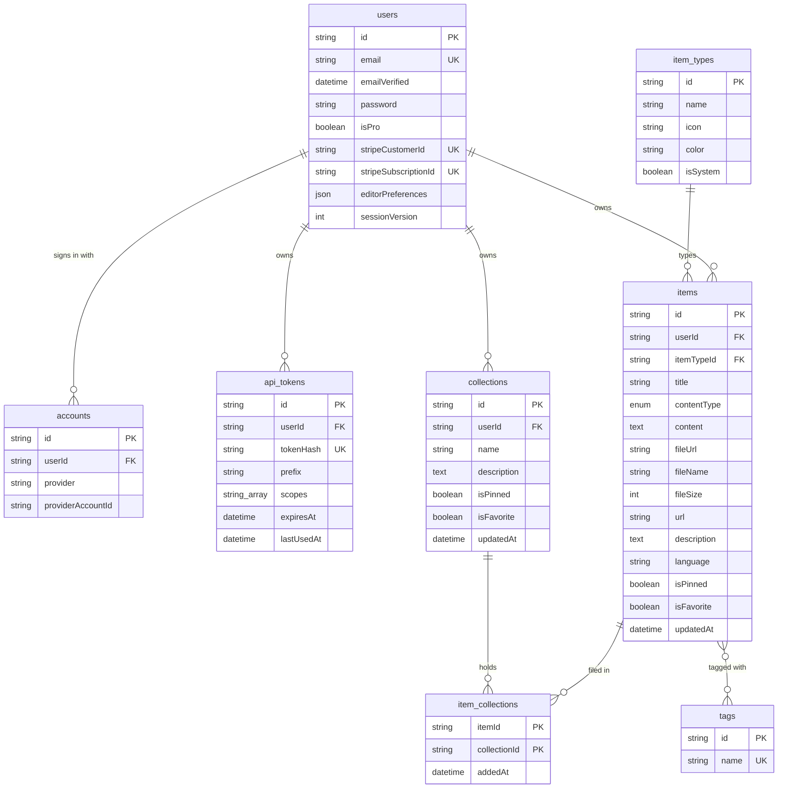

# Data model

One PostgreSQL database, defined in `prisma/schema.prisma` and reached through Prisma 7 with the `@prisma/adapter-pg` driver adapter. The generated client goes to `src/generated/prisma/` (git-ignored).

| Convention | |
|---|---|
| Schema changes | A new migration under `prisma/migrations/`, made with `npm run db:migrate`. `db push` is disabled |
| Ids | `cuid()` strings from Prisma, so they reveal no counts or order. Join tables use a composite key |
| Timestamps | `createdAt` and `updatedAt` on every table a user edits |
| Ownership | Every user-owned table has `userId` with `onDelete: Cascade`, so deleting a user removes everything they own. Queries filter by it in the application |
| Naming | Singular PascalCase models, plural snake_case tables through `@@map` |
| Settings | Per-user preferences are one `Json` column merged over defaults in code |

## Tables

| Table | Holds |
|---|---|
| `users` | The account, the plan (`isPro`, set only by the Stripe webhook), Stripe ids, editor preferences, and `sessionVersion`, bumped to end every session |
| `accounts` | GitHub sign-in links, for the NextAuth adapter |
| `sessions` | The NextAuth adapter's table. Sessions are JWTs, so it stays empty |
| `verification_tokens` | Email verification and password-reset links, keyed by email (or `password-reset:{email}`), stored as SHA-256 hashes |
| `api_tokens` | Personal access tokens: the SHA-256 of the token, a display prefix, scopes, an expiry, when it was last used |
| `items` | Every snippet, prompt, command, note, file, image and link |
| `item_types` | The seven system types, shared by every user |
| `collections` | Named groups of items, which can be pinned and favourited |
| `item_collections` | Which items are in which collections |
| `tags` | Tag names, unique across the app and case-sensitive, deleted once no item uses them |
| `_ItemTags` | Prisma's implicit join between items and tags (columns `A` and `B`) |

## Item types

| Type | Content type | Columns used | Route | Plan |
|---|---|---|---|---|
| `snippet` | `TEXT` | `content`, `language` | `/items/snippets` | Free |
| `prompt` | `TEXT` | `content` | `/items/prompts` | Free |
| `command` | `TEXT` | `content`, `language` | `/items/commands` | Free |
| `note` | `TEXT` | `content` | `/items/notes` | Free |
| `link` | `URL` | `url` | `/items/links` | Free |
| `file` | `FILE` | `fileUrl`, `fileName`, `fileSize` | `/items/files` | Pro |
| `image` | `FILE` | `fileUrl`, `fileName`, `fileSize` | `/items/images` | Pro |

Each type has a Lucide icon name and a colour in its row. The content type comes from the name (`contentTypeFor` in `src/lib/db/items.ts`), and `VALID_ITEM_TYPES` there is the list every action, `/api/v1` and import validates against. Every item also has a title (200 characters), a description (1,000), content up to 500,000 characters and up to 20 tags of 50 characters.

## Indexes

| Index | Serves |
|---|---|
| `items (userId, isPinned, updatedAt, id)` | Every list page: a cursor page is a range of it |
| `collections (userId, isPinned, updatedAt, id)` | The collections list, the same way |
| `items (userId, itemTypeId)` | Counts by type beside each list |
| `items (userId, isFavorite)`, `collections (userId, isFavorite)` | Favorites |
| `items (userId, updatedAt)`, `collections (userId, updatedAt)` | Recent items and collections |
| GIN trigram on item `title`, `content`, `description`, `url`, collection `name`, tag `name` | ⌘K search with `ILIKE '%…%'` |

The trigram indexes are written in `schema.prisma` with `@@index(..., type: Gin)` as well as in their migration, so `prisma migrate dev` doesn't see them as drift.

## Rules kept by the application

| Rule | Where |
|---|---|
| Only the columns of an item's content type are set | `createItem`, `updateItem`, the import |
| An item's collections belong to the item's owner | `lib/db/items.ts` drops collection ids that aren't the caller's |
| A `fileUrl` points into the owner's `{userId}/` folder | `isOwnedFileUrl` before a file URL is stored, read or deleted |
| Free accounts hold at most 50 items and 3 collections | Counted again inside a transaction under a lock on the user's row |
| System type names are unique | The seed checks first, because Postgres treats the null `userId` of system types as distinct |

## Migrations

| Migration | Change |
|---|---|
| `20260108054512_init` | Users and the NextAuth tables, items, item types, collections, the joins and tags |
| `20260119063307_add_query_indexes` | Composite indexes behind the dashboard |
| `20260210052148_add_editor_preferences` | `users.editorPreferences` |
| `20260924225247_add_api_tokens` | The `api_tokens` table |
| `20260927120000_add_collection_pin` | `collections.isPinned` |
| `20260930150000_add_session_version` | `users.sessionVersion` |
| `20261005120000_add_api_token_expiry` | `api_tokens.expiresAt` |
| `20261006190731_add_token_scopes` | `api_tokens.scopes`, with existing tokens given the scopes of the time and a year's expiry |
| `20261007153001_add_search_trigram_indexes` | `pg_trgm` and the six trigram indexes |
| `20261017120000_add_list_order_indexes` | The list-order indexes on items and collections, and `items (userId, itemTypeId)` |

Every migration is backward compatible with the code deployed before it, so it can be applied to production first and the code pushed after.

## Seed

`npm run db:seed` runs `prisma/seed.ts`:

1. Creates each of the seven system item types that doesn't exist yet. Existing rows are left alone, so changing an icon in the seed needs a migration to reach a database that already has it.
2. Upserts the demo account, `demo@bitbin.dev` / `12345678`, verified, on Free.
3. Replaces the demo library with the sample one from `prisma/demo-content.ts`: three collections (React patterns, AI workflows, DevOps) and eighteen items. The daily demo reset runs the same function.

The seed overwrites the demo account, so it refuses any database host not listed in `SAFE_DATABASE_HOSTS` or confirmed once with `CONFIRM_DATABASE_HOST`.
