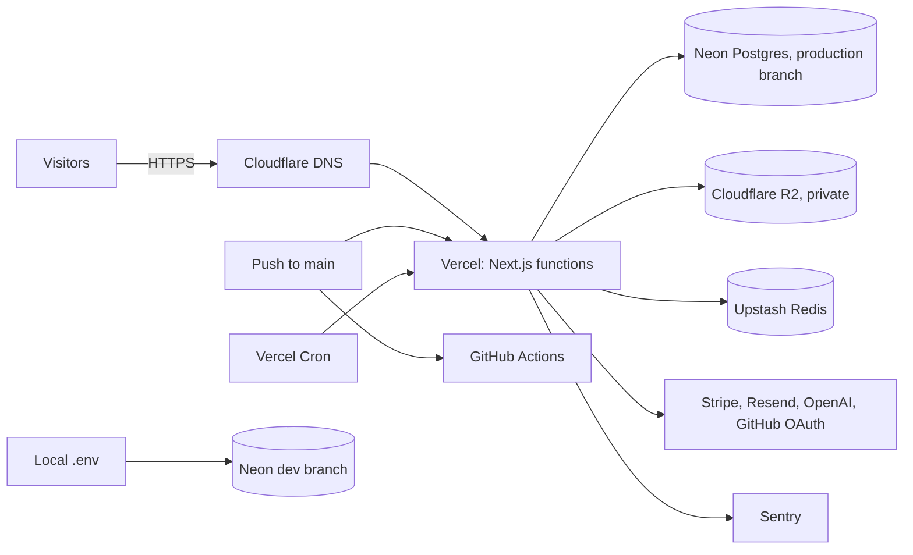
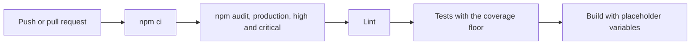

# Deployment

BitBin runs on Vercel at [bitbin.divyanshuagrahari.dev](https://bitbin.divyanshuagrahari.dev), with DNS on Cloudflare. Everything that holds state is a managed service.



| Piece | Runs on | Deploys |
|---|---|---|
| Web app, route handlers, `/api/v1`, crons | Vercel serverless functions | Every push to `main` |
| Database | Neon PostgreSQL, a `production` branch and a `dev` branch for local work | Migrations by hand, before the code that needs them |
| Files | Cloudflare R2, public access off | |
| Rate-limit counters | Upstash Redis | |
| Browser extension | Users' browsers, loaded unpacked | With the web app: the Settings download is built from `extension/` at runtime |
| Desktop app | Users' machines | A `desktop-v*` tag publishes a GitHub Release |

## CI

`.github/workflows/ci.yml` runs on every push to `main` and every pull request, on Node 22:



The build needs every variable to exist but contacts no service, so CI holds no secrets. The coverage report is attached to each run. Vercel builds every push on its own, in parallel with CI.

A second workflow, `desktop-release.yml`, runs on a `desktop-v*` tag: it tests the desktop app, builds the Windows installer on a Windows runner and publishes `BitBin-Setup.exe` as a release. **Settings → Desktop app** links to `releases/latest/download/BitBin-Setup.exe`, so it always points at the newest.

## Releasing a schema change

Vercel doesn't run migrations, and code that reads a column production doesn't have yet fails every query on that table. So:

1. Write the migration backward compatible with the deployed code (new columns nullable or defaulted).
2. Apply it: `DATABASE_URL=<production URL> npm run db:migrate:deploy`.
3. Push the code that uses it.
4. Drop anything old in a later migration, once nothing deployed reads it.

## Production settings

| Variable | Production value |
|---|---|
| `AUTH_URL`, `NEXT_PUBLIC_APP_URL` | `https://bitbin.divyanshuagrahari.dev` |
| `AUTH_SECRET` | Its own secret, not the development one |
| `AUTH_GITHUB_*` | A second GitHub OAuth app, with the production callback |
| `SKIP_EMAIL_VERIFICATION` | Unset |
| `FROM_EMAIL` | `noreply@bitbin.divyanshuagrahari.dev`, on a subdomain verified in Resend |
| `STRIPE_WEBHOOK_SECRET` | The dashboard endpoint's secret, not the one `stripe listen` prints |
| `UPSTASH_*`, `SENTRY_DSN`, `CRON_SECRET` | Set |

The Cloudflare record for the domain is DNS only (grey cloud), so Vercel issues the certificate itself.

| Provider | Setup |
|---|---|
| Stripe | A **BitBin Pro** product with $8 monthly and $72 yearly prices, the Customer Portal on, and a webhook at `/api/webhooks/stripe` for the five events in the [API](api.md#route-handlers). The live site runs in test mode |
| GitHub | An OAuth app with the callback `https://bitbin.divyanshuagrahari.dev/api/auth/callback/github` |
| R2 | A bucket with public access off, and a token with Object Read & Write on it |
| Sentry | Alerts on new and escalating issues |

## Scheduled jobs

| Job | Schedule (UTC) | Route |
|---|---|---|
| Demo reset | Daily, 21:00 | `/api/cron/reset-demo` |
| Unused-file sweep | Sundays, 03:00 | `/api/cron/sweep-files` |

Both are in `vercel.json`, send `Authorization: Bearer $CRON_SECRET`, and can be run by hand from **Vercel → Cron Jobs**. To see what the sweep would delete:

```bash
curl -H "Authorization: Bearer $CRON_SECRET" "https://bitbin.divyanshuagrahari.dev/api/cron/sweep-files?dryRun=1"
```

## Operations

| | |
|---|---|
| Errors | Every `console.error` reaches Sentry, with personal data stripped. Worth an alert: `Rate limit check failed`, `Error handling <event>` from the webhook, `Demo reset failed`, `File sweep aborted` |
| Logs | Vercel → Logs, Cron Jobs and Deployments |
| Webhooks | Stripe → Developers → Webhooks → the endpoint's deliveries |
| Page views | Vercel Analytics |
| Database backups | Neon's point-in-time history of the production branch. To recover, branch from a time before the incident, check it, then restore it |
| Users' own copies | JSON export for everyone, ZIP with files for Pro |

| Secret | Rotating it |
|---|---|
| `AUTH_SECRET` | Signs everyone out. Set it on Vercel and redeploy |
| `CRON_SECRET` | Set it on Vercel; the next run sends it |
| `STRIPE_WEBHOOK_SECRET` | Roll it in Stripe, set it on Vercel, redeploy |
| Provider keys | Create the new key, set it, redeploy, then revoke the old one |

`R2_PUBLIC_URL` never changes once files exist, because stored URLs and object keys are derived from it.

## After a deploy

- Register with a new address, follow the email link and sign in. GitHub sign-in lands on the dashboard in one click.
- Create a snippet, find it with ⌘K straight away, drag it onto a collection.
- Upgrade with the test card, upload an image and a file over 5 MB, suggest tags.
- Export a ZIP and import it into another account.
- Stripe shows the webhook deliveries as `200`, the latest CI run is green, and the browser console shows no Content Security Policy errors.
